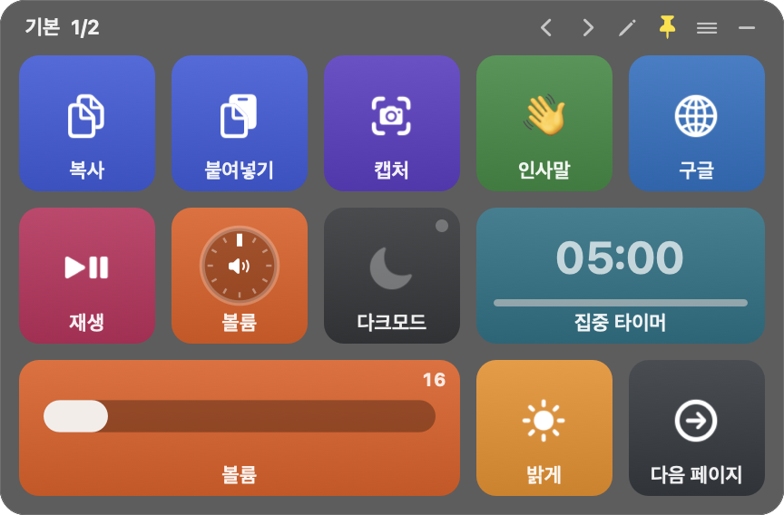
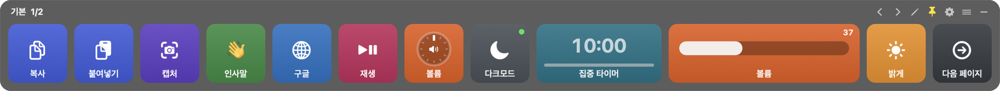
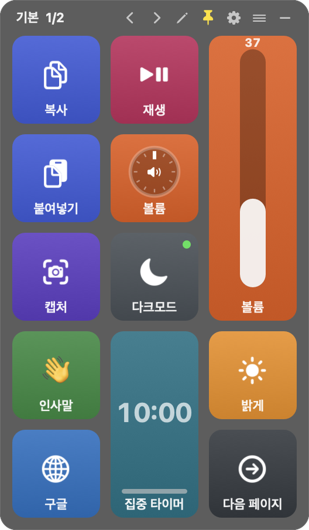
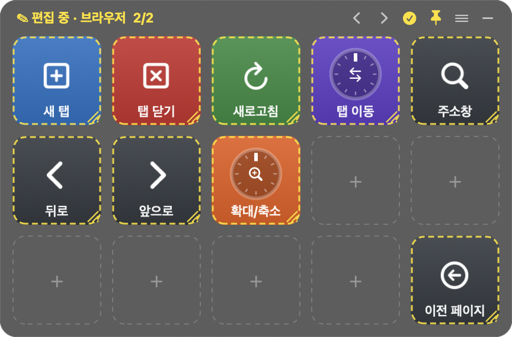
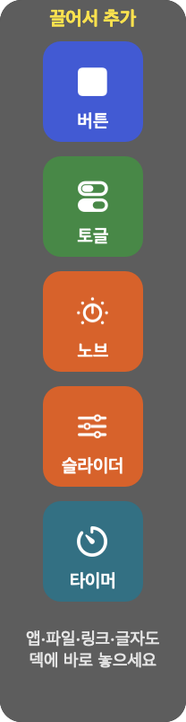
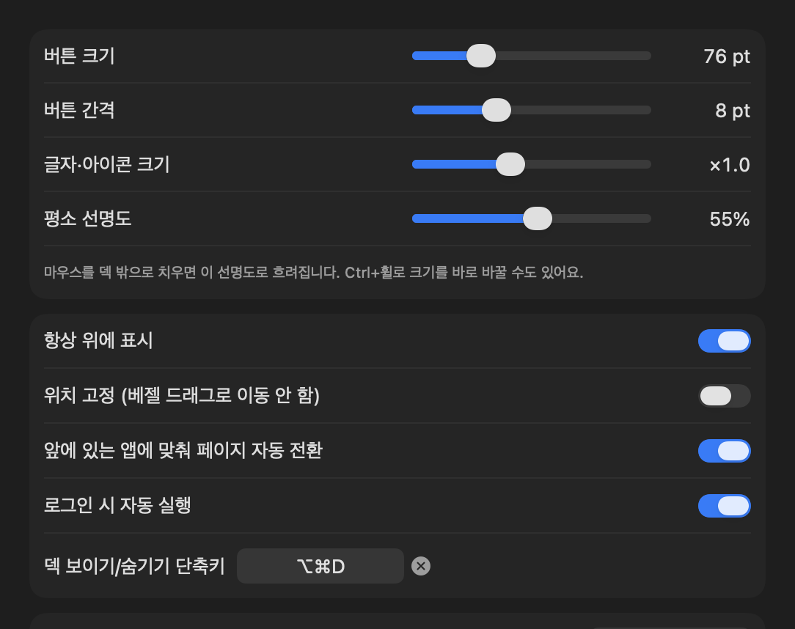

# EasyDeck — macOS용 소프트웨어 스트림덱



[subiDeck](https://superbrainsb.tistory.com/109)(Windows 전용)을 보고 같은 개념을 **macOS 네이티브 앱**으로 만들고 기능을 보완했습니다.
별도 장비 없이 화면에 떠 있는 버튼판에서 단축키, 글자 입력, 앱 실행, 음량·미디어 조절 등을 실행합니다.

🌐 **[소개 페이지](https://raon-easypaster.github.io/easydeck/)** · 📘 **[그림으로 보는 사용 설명서 (PDF)](docs/EasyDeck-설명서.pdf)** · 💬 **[카카오 오픈채팅 문의](https://open.kakao.com/o/pDEupVWi)**

## 배치 예시

| 가로 한 줄 | 가로↔세로 | 편집 모드 |
|---|---|---|
|  |  |  |

| 위젯 팔레트 | 설정 |
|---|---|
|  |  |

## 내려받기

[Releases](../../releases)에서 `EasyDeck.zip`을 받아 압축을 풀고 `EasyDeck.app`을 응용 프로그램 폴더로 옮기세요.
개인 서명 앱이라 처음 열 때 경고가 뜨면 **오른쪽 클릭 › 열기**를 누르세요.

## 빌드 / 실행

```bash
./build.sh            # build/EasyDeck.app 생성
open build/EasyDeck.app
./build.sh install    # /Applications 에 설치 후 실행
```

- macOS 13 이상, Apple Silicon·Intel 겸용(Universal)
- 처음 실행하면 **손쉬운 사용** 권한을 요청합니다 (키 입력·글자 입력에 필요).
- 직접 빌드한다면 처음에 한 번 `./Tools/make_signing_cert.sh`로 이 Mac 전용 서명 인증서를 만들어 두세요.
  그러면 다시 빌드해도 손쉬운 사용 권한이 유지됩니다.
  인증서 없이 빌드하면 임시 서명이 되어, 빌드할 때마다 손쉬운 사용 목록에서 EasyDeck을 `−`로 지우고 `+`로 다시 추가해야 합니다 (스위치만 다시 켜서는 안 됩니다).

## subiDeck과 같은 점

| 기능 | 내용 |
|---|---|
| 위젯 5종 | 버튼, 토글, 노브(무한/유한), 슬라이더(가로/세로), 타이머 |
| 버튼 입력 | 클릭 / 더블클릭 / 길게 누르기(0.5초) 각각 동작 |
| 동작 | 단축키, 글자 입력(한글), 앱·파일·폴더·웹 열기, 셸 명령, 음량, 미디어, 밝기, 다크 모드, 대기 |
| 아이콘 | SF 심볼, 이미지(PNG/JPG/SVG/ICNS), 글자·이모지 / 배경·글자색 |
| 화면 | 클릭해도 작업 중인 앱 포커스 유지, 평소 흐리게, 항상 위, 위치 고정 |
| 편집 모드 | 빈 칸 + 로 추가, 드래그 이동(초록/빨강 표시), 모서리로 크기 조절 |
| 크기 | Ctrl+휠로 덱 크기 조절 |

## 보완한 점

- **macOS 지원** (원본은 Windows 전용)
- **끌어다 놓기 편집**: Finder의 앱·파일·폴더, 브라우저 링크, 선택한 글자를 덱에 놓으면 버튼이 자동으로 생김 (아이콘 포함). 버튼 위에 놓으면 동작 바꾸기·덧붙이기, 이미지는 아이콘으로. 빈 칸이 없으면 덱이 늘어남
- **편집 팔레트**: 편집 모드에서 옆에 뜨는 팔레트에서 위젯을 끌어다 원하는 칸에 추가, 위젯끼리 끌어 놓으면 **자리 바꾸기**
- **배치 바꾸기**: 가로 한 줄 / 세로 한 줄 / 가로↔세로 전환, 바로 되돌리기 (≡ 메뉴 › 배치 바꾸기)
- 상단 **⚙︎ 톱니바퀴**로 설정 창 열기 (덱이 좁으면 덜 쓰는 버튼은 자동으로 숨김, 오른쪽 클릭 메뉴로 모두 사용 가능)
- **여러 페이지** + 베젤 휠/스와이프·`page` 동작으로 전환
- **앱별 자동 페이지 전환**: 크롬이 앞에 오면 '브라우저' 페이지 등
- **위젯별 전역 단축키**: 덱을 안 눌러도 키보드로 버튼 실행
- **덱 보이기/숨기기 전역 단축키** (기본 ⌥⌘D)
- 동작 추가: `paste`(클립보드 경유, 원래 클립보드 복원), `applescript`, `shortcut`(단축어 앱), `notify`, `sound`, `page`, `deck`
- 슬라이더/노브를 **시스템 음량에 연결**하고 덱에 마우스를 올리면 실제 음량과 동기화
- 노브/슬라이더 값 `{value}` 를 동작에 넣어 셸·스크립트에 전달
- 편집 창에서 **키 녹화**, 동작 예시 메뉴, **▶︎ 테스트 실행**
- `profile.json` 을 직접 고치면 **즉시 반영**, 형식이 깨지면 원본을 보관하고 기본값으로 시작
- 프로필 **내보내기/가져오기**, 기본 배치로 되돌릴 때 자동 백업
- 메뉴 막대 아이콘 (Dock에는 안 보임), 로그인 시 자동 실행

## 동작 문법 (한 줄에 하나, 위에서부터 순서대로)

```
key cmd+shift+4          단축키 (여러 개: key cmd+k cmd+s)
type 안녕하세요\n반가워요   글자 입력 (\n 줄바꿈)
paste 긴 문장             클립보드로 붙여넣기
open https://…  |  ~/Downloads  |  Safari  |  com.apple.Notes
shell say 안녕            zsh 명령 (창 없이)
applescript beep
shortcut 단축어이름
volume up|down|mute|50|+5|-5
media play|next|prev
brightness up|down
darkmode toggle|on|off
delay 0.5
page 이름|next|prev|2
layout row|column|flip|undo   배치 바꾸기
notify 메시지   sound Glass   deck hide|show|toggle
# 주석
```

## 설명서·문의

- 사용 설명서 PDF: [docs/EasyDeck-설명서.pdf](docs/EasyDeck-설명서.pdf) (원본 `docs/manual.html`, Chrome으로 PDF 인쇄)
- 버그·바라는 기능: [카카오 오픈채팅](https://open.kakao.com/o/pDEupVWi) 또는 [Issues](../../issues)

## 파일

`~/Library/Application Support/EasyDeck/`

- `profile.json` — 페이지·위젯·동작·설정
- `icons/` — 추가한 아이콘 이미지
- `EasyDeck.log` — 실행 기록·오류

## 소스 구조

| 파일 | 역할 |
|---|---|
| `Sources/Model.swift` | 데이터 모델, 저장·파일 감시, 로그 |
| `Sources/Actions.swift` | 동작 해석·실행, 키/미디어 입력, 권한 |
| `Sources/Keys.swift` | 키 이름↔키코드, 전역 단축키(Carbon) |
| `Sources/Deck.swift` | 떠 있는 덱 창, 페이지, 베젤, 타이머, 토스트 |
| `Sources/WidgetView.swift` | 위젯 그리기와 마우스/휠 조작, 편집 드래그 |
| `Sources/Inspector.swift` | 위젯 편집 창·설정 창(SwiftUI), 로그인 항목 |
| `Sources/main.swift` | 앱 진입점, 메뉴 막대 |

## 알려진 제한

- 외장 모니터 밝기(DDC/CI)와 Night Shift는 지원하지 않습니다 (`brightness`는 내장 화면/Apple 디스플레이용 키 신호).
- 일부 보안 입력 칸(암호 입력 등)과 일부 게임에서는 키 입력이 막힙니다.
- `type`은 한글 입력기 상태에 따라 드물게 어긋날 수 있어요. 그럴 땐 `paste`를 쓰세요.
- 다크 모드 전환은 처음 한 번 'System Events' 제어 허용을 묻습니다.
